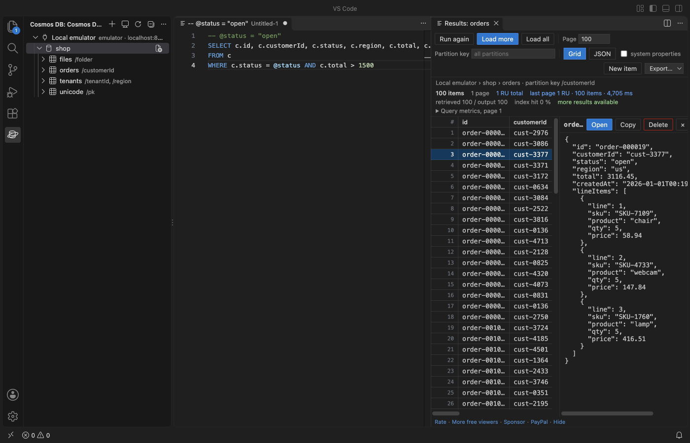

# Cosmos DB Client & Azure Cosmos DB Explorer for VS Code

Free Cosmos DB client for the NoSQL API. Connect with a connection string, an endpoint and key, or the local emulator in one click. No Azure sign-in, no account, no telemetry. The extension talks only to the Cosmos DB endpoints you add (and to Microsoft sign-in, only if you choose Entra ID for a connection).

Not made by, affiliated with or endorsed by Microsoft. "Azure" and "Cosmos DB" are Microsoft trademarks, used here only to say what this extension connects to.



## What you get, free

- Connect in seconds. Paste the connection string from Keys in the Azure portal, or click Connect to Local Emulator. Keys are kept in VS Code's secret storage, never in settings. The emulator's self-signed certificate is accepted for `localhost` only.
- Explorer. Databases, containers (partition key, throughput, indexing policy shown read-only), stored procedures, triggers and user-defined functions.
- Queries with the cost on every page. Click a container to run `SELECT * FROM c`, or write your own query in a `.nosql` file and press Ctrl+Enter (Cmd+Enter on macOS). Each page shows its request units (RU), the running RU total, documents loaded against returned, the index hit ratio and the server times.
- Continuation paging without a freeze. Load more reads the next page with the continuation token. Load all keeps going, with a Stop button. The grid and the JSON view draw only the rows on screen, so 50,000 loaded items scroll as fast as 50.
- Parameters, partition scope, page size. Write a line `-- @status = "open"` and use `@status` in the query. Set a partition key value in the toolbar to scope the query to one partition, or leave it empty to query across partitions.
- Autocomplete of property names from a 100-item sample of the container, plus keywords and built-in functions.
- Edit items safely. Double-click a row to open the item as JSON; Ctrl+S saves it back. The save uses the id and partition key the item had when you opened it and an ETag check, so a change someone else made in the meantime is never overwritten silently. You can compare with the server version first.
- Exact numbers. JavaScript loses digits above 9,007,199,254,740,991. This client keeps `9007199254740993` exactly as stored, shows it with a warning badge, and never rewrites it when you edit another field.
- Create and delete with a partition key prompt and a confirmation before every delete.
- Streamed export of a whole query to JSON, JSONL or CSV, with a progress bar and the RU used. Memory stays flat at 200,000 items.
- Import JSON or JSONL in batches (bulk API), with a progress bar and a running RU total. Upsert or create only.
- Read-only switch per connection: blocks saves, deletes, imports and stored procedure runs on it.
- Works in Cursor, Windsurf and VSCodium (published on Open VSX too).

## Why this one

Measured or linked, so you can check:

- Open VSX. Microsoft's Azure Cosmos DB extension is not on Open VSX (the registry Cursor, Windsurf and VSCodium install from returns 404 for it, checked 9 Nov 2026). This one is.
- Large results stay responsive. A freeze when switching to the JSON view with about 100 large documents was reported in [microsoft/vscode-cosmosdb#3192](https://github.com/microsoft/vscode-cosmosdb/issues/3192) (since fixed there). Here both views are virtualized and were tested with 200,000 items of nested orders and with 1.9 MB items.
- No silent overwrite. [microsoft/vscode-cosmosdb#3263](https://github.com/microsoft/vscode-cosmosdb/issues/3263) asked for an ETag precondition on saves (since added there). Every save here has used one from the first version.
- RU and metrics on every page, not only in a separate view, and a connection string or the emulator is enough: no Azure subscription list, no sign-in.
- Small and quick. The package is under 0.5 MB, activation took 9 ms in the test, and the SDK loads only when you connect.

## Get started

1. Open the Cosmos DB view in the Activity Bar.
2. Click Connect to Local Emulator, or Add Connection and paste a connection string (`AccountEndpoint=...;AccountKey=...;`).
3. Expand a database and click a container. The results open next to the query.

The local emulator on macOS and Linux runs in Docker:

```
docker run -d -p 8081:8081 -p 1234:1234 mcr.microsoft.com/cosmosdb/linux/azure-cosmos-emulator:vnext-preview
```

### Query files

```sql
-- Parameters: one line per parameter, JSON or plain text
-- @status = "open"
-- @min = 100
SELECT c.id, c.customerId, c.total
FROM c
WHERE c.status = @status AND c.total > @min
ORDER BY c.total DESC
```

The results toolbar has the page size, the partition key value (empty means all partitions; a JSON array such as `["acme","eu"]` for hierarchical keys), Load more, Load all, the grid or JSON view, system properties and Export.

## Zovo Pro (optional)

Two tools for people who pay for request units. Each can be tried 3 times for free. Zovo Pro is USD 19 once and adds the Pro tools to every Zovo extension. Everything listed under "What you get, free" stays free.

- Query Cost Report. Runs the query to the end and writes a report: total RU, RU per item and per page, documents loaded against returned, index hit ratio, the indexes the server suggests (from index metrics) and a ready indexing policy with them, plus plain hints such as a missing partition key filter or a deep OFFSET.
- Copy Container. Streams every item of a container to another container, in the same or another account (for example from production to the emulator). The target is created with the same partition key and indexing policy. Progress shows read and write RU.

Buy on [GitHub Sponsors](https://github.com/sponsors/theluckystrike/sponsorships?tier_id=679878) ("$19 one time") and choose Unlock with GitHub Sponsors, or pay with PayPal and get a license key. The setting `zovoCosmos.showProFeatures` hides the Pro tools.

## Settings

| Setting | Default | What it does |
|---|---|---|
| `zovoCosmos.pageSize` | 100 | Items per page (max item count) |
| `zovoCosmos.maxLoadedItems` | 50000 | Items kept in one results view; export streams every item |
| `zovoCosmos.timeoutSeconds` | 30 | Request timeout, with a clear message instead of a hang; Load all retries a slow page twice |
| `zovoCosmos.emulatorPort` | 8081 | Port for Connect to Local Emulator |
| `zovoCosmos.exportSystemProperties` | false | Keep `_rid`, `_etag`, `_ts` and the others in exports |
| `zovoCosmos.costReportMaxPages` | 200 | Page limit of the Query Cost Report |
| `zovoCosmos.askForRating` | true | One rating question after real use, never after an error |
| `zovoCosmos.showSupportLinks` | true | The small links under the results |
| `zovoCosmos.showProFeatures` | true | Show the Zovo Pro tools |

## Privacy and network

- Requests go only to the account endpoints you add. Microsoft sign-in is used only for a connection you set up with Entra ID.
- No telemetry, no analytics, no update checks, nothing at startup. The SDK loads on your first connect.
- Account keys are stored with VS Code's SecretStorage (the operating system keychain).
- Supported API: Azure Cosmos DB for NoSQL. The MongoDB, Cassandra, Gremlin and Table APIs are not covered.

## Limits

- The emulator for Linux (vnext) accepts any key, so a wrong-key error appears only with a real account.
- Items are capped at 2 MB by Cosmos DB; large items open in the editor, and the detail pane shows the first 256 KB.
- CSV columns come from the first page of results; JSONL keeps every field.

## Support Zovo

Zovo extensions are free, with no ads and no tracking. They are made by [theluckystrike](https://github.com/theluckystrike) on GitHub. If this one saves you time, you can support the work:

- [Sponsor on GitHub](https://github.com/sponsors/theluckystrike)
- [PayPal](https://www.paypal.com/paypalme/najzzz)
- [Follow theluckystrike on GitHub](https://github.com/theluckystrike)

### Need your format supported?

Open a [format request](https://github.com/theluckystrike/cosmos-db-client-vscode/issues/new?template=format-request.yml) with a sample file, and I reply there whether it can be done. For USD 299 once, through [this GitHub Sponsors tier](https://github.com/sponsors/theluckystrike/sponsorships?tier_id=679995), I add your file format or a missing feature to this extension, with tests, within 7 days.

## More tools by Zovo

- [Postgres & MySQL Query Client - SQL Database Tool (SQLite, CSV Export)](https://marketplace.visualstudio.com/items?itemName=zovo.zovo-sql-client) Free PostgreSQL client and MySQL client for VS Code: unlimited connections, edit rows, streamed CSV export. Run SQL with Ctrl+Enter, browse tables, cancel long queries. Also MariaDB and SQLite. No sign-in, no telemetry, no keep-alive queries.
- [Large JSON Viewer, JSON Browser & JSON Tree](https://marketplace.visualstudio.com/items?itemName=zovo.zovo-json-tree-viewer) shows large JSON files as a searchable tree, copies JSONPath and turns arrays of objects into a table.
- [JSONL Viewer, Large JSONL Table & NDJSON Viewer](https://marketplace.visualstudio.com/items?itemName=zovo.zovo-jsonl-viewer) opens JSONL and NDJSON files as a table, as records or as a chat view.
- [SQLite Viewer & SQLite3 DB File Browser, Database Explorer](https://marketplace.visualstudio.com/items?itemName=zovo.sqlite-table-viewer) browses SQLite tables read-only and runs SELECT queries.
- [GeoJSON Viewer, KML Viewer & GPX Viewer (Map Preview, Shapefile)](https://marketplace.visualstudio.com/items?itemName=zovo.zovo-geo-map-viewer) GeoJSON viewer, KML viewer and GPX viewer with a map preview in VS Code. Also opens shapefiles (SHP, zipped), KMZ, TopoJSON, WKT and CSV with lat/lon: feature table, properties, GPX distance and elevation profile, reprojection from .prj, PNG export. Free, no sign-in, works offline.

See [all Zovo extensions on the Marketplace](https://marketplace.visualstudio.com/publishers/zovo).

## More from zovo

- [All free zovo VS Code extensions](https://marketplace.visualstudio.com/publishers/zovo) — file viewers, database clients, formatters. Offline, no telemetry, no sign-up.
- [Full MCP server catalogue](https://theluckystrike.github.io/mcp/) — local-first MCP servers for back-office work: invoices, VAT, PDFs, spreadsheets, payroll.
- [Hosted no-install MCP endpoints](https://mcp.zovo.one) — paste a URL in Claude / Cursor, nothing to install.
